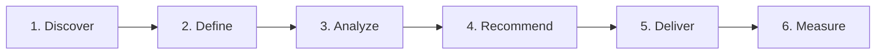

# Hi, I'm Harshal Gopalani 👋

### **Business Analyst | AI Product Strategy | Data-Driven Decision Making**

I bridge the gap between business strategy, data-driven insights, and AI-powered product development. My focus is on translating complex stakeholder requirements into actionable product roadmaps, analyzing structured datasets to drive business decisions, and identifying high-ROI opportunities for process optimization and intelligent automation.

Combining hands-on technical capabilities in Python, SQL, and LLM architecture with a product-owner mindset, I help organizations evaluate AI feasibility, optimize operational efficiency, and deliver technology solutions strictly aligned with core business objectives.

**Long-term Focus:** AI Product Consulting — guiding enterprises through AI use-case discovery, technical feasibility assessment, build-vs-buy evaluation, and ROI optimization for practical, AI-enabled solutions.

---

## 🧠 Core Competencies

### 📊 Business Analysis & Decision Support
* **Requirements Engineering:** Business Requirements Documents (BRDs), Functional Requirements Specifications (FRS), and Stakeholder Elicitation.
* **Process Optimization:** AS-IS / TO-BE Workflow Mapping, Gap Analysis, Root Cause Analysis (RCA), and Impact Analysis.
* **Agile Artifacts:** User Stories, Acceptance Criteria (Gherkin syntax), Use Case Modeling, and Backlog Refinement.
* **Strategic Alignment:** KPI Definition, Performance Benchmarking, Business Reporting, and Cross-Functional Stakeholder Validation.

### 📈 Data Analytics & Business Intelligence
* **SQL Engineering:** Query Optimization, Multi-Table Joins, Complex Aggregations, CTEs, and Window Functions.
* **Python for Analytics:** Data Manipulation, Cleaning, Transformation, and Exploratory Data Analysis (EDA) using `Pandas` and `NumPy`.
* **Data Processing:** Google BigQuery, Structured Data Processing, Data Validation, and Data Quality Assurance.
* **Performance Tracking:** Trend Analysis, Operational Metrics Tracking, and Executive Insight Generation.

### 🚀 Product Management & Strategy
* **Product Discovery:** Customer Problem Validation, Opportunity Identification, and Product Requirements Documents (PRDs).
* **Frameworks & Prioritization:** Feature Scoring using RICE, MoSCoW, and Impact vs. Effort Matrix.
* **Agile Execution:** MVP Scoping, Hypothesis-Driven Development, Scrum Ceremonies, and Backlog Prioritization.
* **Product Success:** Adoption Tracking, User Engagement Metrics, Task Completion Rates, and Continuous Product Improvement.

### 🤖 AI Product Consulting & Transformation
* **Strategic Feasibility:** AI Use-Case Discovery, Technical-Business Alignment, and Build vs. Buy Evaluation.
* **LLM Architecture:** Retrieval-Augmented Generation (RAG), Agentic Workflows, and Knowledge Management Systems.
* **LLM Ops Considerations:** Token Cost Optimization (COGS), Latency Reduction, Response Quality Evaluation, and Fallback Routing.
* **Governance & Workflows:** Human-in-the-Loop (HITL) Workflow Design, Risk Identification, and Expected ROI Estimation.

---

## 🛠️ Technical Toolkit

| Category | Technologies & Frameworks |
| :--- | :--- |
| **Data & Querying** | SQL, Python (`Pandas`, `NumPy`), Google BigQuery |
| **AI & LLM Architecture** | Retrieval-Augmented Generation (RAG), LLM APIs (Groq), Agentic Workflows, Vector Databases (ChromaDB) |
| **Backend & Integration** | FastAPI, RESTful APIs, JSON, Pydantic |
| **Product & Delivery** | PRDs, BRDs, User Stories, Gherkin, Agile/Scrum |
| **DevOps & Tools** | Git, GitHub, GitHub Actions (CI/CD) |

---

## 🏆 Professional Certifications

* **Certified Python Associate (CPA)** — Accredion *(Issuing Authority: MISAC, California, USA)*
* **Microsoft AI Product Management Certification** — Microsoft
* **IBM RAG and Agentic AI Certification** — IBM
* **Microsoft AI Engineering Certification** — Microsoft
* **Google Professional Project Management Certificate** — Google
* **Python Institute Certified Associate** — Python Institute

---

## 🚀 Featured Projects

### 1. [Project Adaptive Depth — AI Response Optimization](https://github.com/Harshalgopalani/Project-Adaptive-Depth-LLM-Response)
* **Role:** AI Product Manager / Lead Business Analyst  
* **Focus:** Cost Optimization · Requirements Analysis · UX Engineering · Technical Feasibility  
* **Overview:** Designed a decoupled, three-tier adaptive AI response architecture that intercepts user queries via a sub-50ms intent router to dynamically match LLM token depth with user intent.
* **Key Impact:**
  * Identified token-cost inefficiencies caused by default LLM verbosity ("wall of text") and mapped out a dynamic token-bounding strategy.
  * Formulated strict BRDs, User Stories, and a JSON Prompt Registry to constrain primary LLMs (Claude/GPT-4) for low-complexity queries.
  * Achieved an estimated **15% reduction in inference compute COGS** while lowering Read-Time-to-Action (RTTA) for end-users.
* **Tech Stack:** Python, FastAPI, Groq API, Pydantic, GitHub Actions

---

### 2. [Real Estate RAG Automator](https://github.com/Harshalgopalani/realestate-rag-saas.git)
* **Role:** AI Product Developer / Product Owner  
* **Focus:** Customer Experience · Workflow Automation · Lead Qualification  
* **Overview:** Prototyped an autonomous Retrieval-Augmented Generation (RAG) solution to automate 24/7 customer inquiry handling and qualify inbound real estate leads.
* **Key Impact:**
  * Analyzed real estate customer journey bottlenecks to define prompt constraints and ChromaDB vector retrieval rules.
  * Automated initial property inquiry responses and lead scoring, drastically reducing initial response latency.
  * Grounded LLM responses strictly within private property catalog chunks to eliminate hallucination risks.
* **Tech Stack:** Python, FastAPI, ChromaDB, Groq API, RAG

---

### 3. [AI Document Analyzer for FinTech](https://github.com/Harshalgopalani/AI-Document-analyzer-for-Fintech-companies-to-Analyze-financial-10K-Reports-and-curate-Metrics.git)
* **Role:** AI Solution Developer / Product Architect  
* **Focus:** Financial Data Structuring · Decision Support · Process Automation  
* **Overview:** Developed an automated financial intelligence tool that extracts, structures, and categorizes key financial metrics from complex, unstructured company 10-K filings.
* **Key Impact:**
  * Engineered an information retrieval pipeline to convert unstructured PDF filings into validated Pydantic JSON schemas.
  * Accelerated research workflows for financial analysts by providing instant extraction of balance sheet and income statement metrics.
* **Tech Stack:** Python, FastAPI, LLMs, RAG, Vector Databases, Pydantic

---

### 4. Denzeye.ai — Core Infrastructure
* **Role:** Python Developer  
* **Focus:** Workflow Reliability · Infrastructure Support · Operational Efficiency  
* **Overview:** Built foundational Python automation scripts and environment management tooling to streamline continuous development workflows.
* **Key Impact:**
  * Scripted automated logging and structured JSON object management for local runtime environments.
  * Maintained Git version control hygiene and environment configuration standards.
* **Tech Stack:** Python, Git, JSON

---

## 🔍 My Approach to Business Analysis



1. **Discover:** Elicit stakeholder needs, map customer pain points, and align on business objectives.
2. **Define:** Document formal business requirements (BRD/PRD), scope boundaries, and acceptance criteria.
3. **Analyze:** Leverage process mapping (AS-IS/TO-BE) and data analysis to identify operational bottlenecks.
4. **Recommend:** Evaluate potential solutions based on financial ROI, technical feasibility, and organizational risk.
5. **Deliver:** Partner closely with engineering teams in Agile sprints to validate implementation against criteria.
6. **Measure:** Track post-launch adoption against defined KPIs to drive continuous improvement.

---

## 💡 My Approach to AI Product Consulting

1. **Opportunity Discovery:** Identify high-repetition workflows, information retrieval bottlenecks, and high-cost manual processes.
2. **Use-Case Validation:** Assess data availability, technical feasibility, user demand, and expected business value.
3. **Solution Specification:** Define functional schemas, token budgets, user guardrails, and target latency SLAs.
4. **MVP Scoping:** Prioritize core capabilities to minimize time-to-market while maximizing initial feedback loops.
5. **Evaluation & Governance:** Benchmark response quality, hallucination rates, API cost per transaction, and system latency.
6. **Strategic Roadmap:** Guide leadership on continuous iteration, full production scaling, or build-vs-buy decisions.

---

## 📌 Success Metrics Framework

I evaluate business and AI product initiatives through rigorous, quantifiable outcomes:

* **Operational Efficiency:** Process completion time, manual labor hours saved, error reduction rate.
* **Financial Optimization:** Cost-per-query (LLM COGS), overall ROI, and implementation payback period.
* **User & Product:** Feature adoption rate, monthly active users (MAU), task success rate, and CSAT.
* **AI & System Performance:** Retrieval relevance (MRR/NDCG), response latency (TTFT), token efficiency, and fallback rates.

---

## 📈 GitHub Statistics
!Harshal's GitHub stats
---

## 🤝 Let's Connect

I am actively open to opportunities in **Business Analysis**, **AI Product Management**, and **AI Product Consulting**. I welcome discussions on optimizing business processes, defining technical product strategies, or building practical AI solutions.

* **GitHub:** [github.com/Harshalgopalani](https://github.com/Harshalgopalani)
* **LinkedIn:** *(www.linkedin.com/in/ai-pm-harshal-gopalani)*

```
